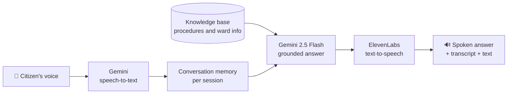

<div align="center">

# 🎙️ DigiWard Voice AI API

**A Vietnamese voice assistant for ward-level digital government. Citizens ask about administrative procedures out loud and hear the answer back.**


</div>

---

## Overview

Many residents find online public-service portals hard to use, and phone lines at the ward office are busy. DigiWard lets a citizen simply **speak a question** such as *"What do I need to register a birth?"* and get a short spoken answer that follows the ward's own procedure documents.

- **Voice in, voice out.** One request takes an audio recording and returns the transcript, the answer text and the spoken answer.
- **Grounded answers.** The assistant answers from a local knowledge base of procedures (birth registration, marriage, land) and ward information, and is instructed not to invent regulations and to ask back when information is missing.
- **Multi-turn conversations.** Each `sessionId` keeps its own conversation history, so follow-up questions such as *"and how long does it take?"* make sense.
- **Short, citizen-friendly replies.** Answers are in Vietnamese and capped at about 150 words so they work well as audio.

## How it works



| Service | Responsibility |
| --- | --- |
| `GeminiAudioService` | Transcribes the uploaded recording with Gemini |
| `KnowledgeService` | Loads the Markdown knowledge base from `Knowledge/` |
| `ConversationMemoryService` | Stores the message history for each session |
| `GeminiService` | Builds the prompt from rules, knowledge and history, and calls Gemini |
| `ElevenLabsService` | Turns the answer into MP3 speech |
| `VoiceAssistantService` | Orchestrates memory → Gemini → ElevenLabs |

## API

Base path: `/api/v1/voice`

| Method | Endpoint | Input | Output |
| --- | --- | --- | --- |
| `GET` | `/test` | none | Health check |
| `POST` | `/transcribe` | `audio` file (form-data) | `{ text }` |
| `POST` | `/ask` | `{ "text": "..." }` | `{ question, answer }` |
| `POST` | `/speak` | `{ "text": "..." }` | MP3 audio |
| `POST` | `/chat` | `audio` file + `sessionId` | `{ success, question, answer, audioBase64, mimeType }` |

Example, a full voice turn:

```bash
curl -X POST "http://localhost:5243/api/v1/voice/chat?sessionId=citizen-01" \
  -F "audio=@question.webm"
```

```json
{
  "success": true,
  "question": "Làm giấy khai sinh cần giấy tờ gì?",
  "answer": "Bạn cần tờ khai đăng ký khai sinh, giấy chứng sinh ...",
  "audioBase64": "<mp3 bytes>",
  "mimeType": "audio/mpeg"
}
```

## Getting started

**Requirements:** .NET 10 SDK, a Google Gemini API key, an ElevenLabs API key.

```bash
git clone https://github.com/ngminhthotech/DigiWard-Voice-API.git
cd DigiWard-Voice-API
cp appsettings.example.json appsettings.json   # then fill in the two API keys
dotnet run
```

The API listens on `http://localhost:5243` by default. Keep real keys out of source control; `appsettings.json` should stay local.

### Extending the knowledge base

Add or edit Markdown files under `Knowledge/` (for example `Knowledge/Procedures/<procedure>.md`). They are loaded into the assistant's context, so new procedures are available without code changes.

```text
Knowledge/
├── Procedures/   khai-sinh.md, ket-hon.md, dat-dai.md
├── Local/        phuong-vithanh.md
└── FAQ/          health insurance and public-service FAQs
```

## Project structure

```text
DigiWard-Voice-API/
├── Controllers/     VoiceController: transcribe, ask, speak, chat
├── Services/        Gemini, Gemini audio, ElevenLabs, knowledge, memory, orchestration
├── Models/          request and response models
├── Configurations/  ElevenLabs settings
├── Knowledge/       procedures and local information used to ground answers
└── Program.cs       dependency injection and HTTP clients
```

## Roadmap

- [ ] Retrieve only the relevant procedures per question (embeddings) instead of loading the whole knowledge base
- [ ] Persist conversation memory (Redis or a database) instead of in-process memory
- [ ] Streaming audio responses for lower latency
- [ ] Web widget for the ward's public-service portal

## Author

**Nguyen Minh Tho** · [@ngminhthotech](https://github.com/ngminhthotech)
